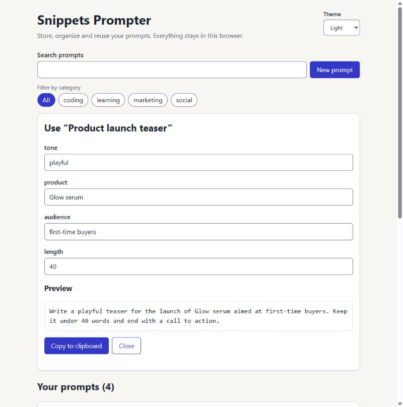

# Snippets Prompter

Store, organize and reuse the prompts and text snippets you use every day.
Prompts live in free-form categories and can contain `{{variables}}` that you
fill in before copying the final text to the clipboard.

Everything runs in the browser and is saved in `localStorage`: no account, no
server.

<picture>
  <source media="(prefers-color-scheme: dark)" srcset="docs/screenshot-dark.jpg">
  
</picture>

## Features

- Create, edit and delete prompts (with a confirmation step before deleting).
- Free-form categories, created as you type them; filter the list by category.
- **Create from**: start a new prompt from an existing one. The new prompt
  remembers its source; if the source is later deleted, the link is simply
  ignored.
- **Variables**: write `{{product}}` or `{{ tone }}` in a prompt, fill the
  values in, preview the result and copy it.
- Free-text search over title and body.
- Persists across reloads. Corrupted stored data never crashes the app.
- Light and dark themes: follows the system setting by default, or pick one
  (the choice is remembered).
- Keyboard and screen reader friendly (see [Accessibility](#accessibility)).

## Run it

Requires Node.js 20 or newer.

```bash
cd frontend
npm install
npm run dev        # development server
npm test           # unit, component and accessibility tests
npm run build      # type-check and production build
npm run preview    # serve the production build locally
```

## Stack and why

| Choice | Why |
| --- | --- |
| React + TypeScript + Vite | Fast feedback loop; the types are the documentation of the data model. |
| React Hook Form + Zod | One schema is the single source of truth for validation and form types. |
| `localStorage` | The scope is a personal tool; a backend would add moving parts without adding value yet (see [ADR 0003](docs/adr/0003-scope-pivot-frontend-only.md)). |
| Vitest + Testing Library + jest-axe | Tests exercise the app the way a user does, plus automated accessibility checks. |
| CSS custom properties (`src/styles/tokens.css`) | Components never use raw values, so the look can change in one file (or be swapped for a shared design system). |
| CSS `light-dark()` + `color-scheme` | Each colour token holds its light and dark value side by side, so the two themes cannot drift apart; native controls (scrollbars, selects) follow the theme too. |

## Project structure

```
frontend/src/
  App.tsx              screen: search, filters, list, and the form/panel above it
  components/          PromptCard, PromptForm, VariablePanel, ThemeSwitcher
  ui/                  Button, Input/Textarea, Card (small, typed, reusable)
  hooks/               usePrompts (collection + persistence), useTheme
  lib/                 pure logic: variables, filtering, storage, schema, seed data
  styles/              design tokens and app styles
```

Pure logic is kept out of components on purpose: it is trivial to test and
the components stay thin.

## Data model

```ts
interface Prompt {
  id: string;
  title: string;
  body: string;
  categories: string[];
  sourceId?: string; // the prompt it was created from, if any
}
```

See [`docs/data-model.md`](docs/data-model.md) for how this maps to the original
relational design.

## Accessibility

- Every input has a visible label; hints and errors are linked with
  `aria-describedby`; errors use `role="alert"`.
- Focus moves into the form or the variable panel when it opens, and back to
  the button that opened it when it closes. `Escape` closes either one.
- Deleting keeps focus on the confirm/keep buttons, then moves it to the list
  heading once the prompt is gone.
- Saving, deleting, copying and the number of search matches are announced
  through `role="status"` regions.
- Category filters are real buttons with `aria-pressed`; the theme switcher is
  a native `<select>`.
- Both themes meet WCAG AA contrast: 4.5:1 for text, 3:1 for control borders
  and the focus ring.
- Automated checks with axe run for the main view, the form with errors and
  the variable panel, plus tests for focus management and announcements.
  Automated checks do not replace manual testing with a keyboard and a screen
  reader.

## Decisions

Architecture decisions are recorded in [`docs/adr/`](docs/adr). The plan and
what is deliberately out of scope are in
[`docs/vision-and-roadmap.md`](docs/vision-and-roadmap.md).

## Sample data

The example prompts are made up. Never commit real client or campaign content.

## License

[MIT](LICENSE)
